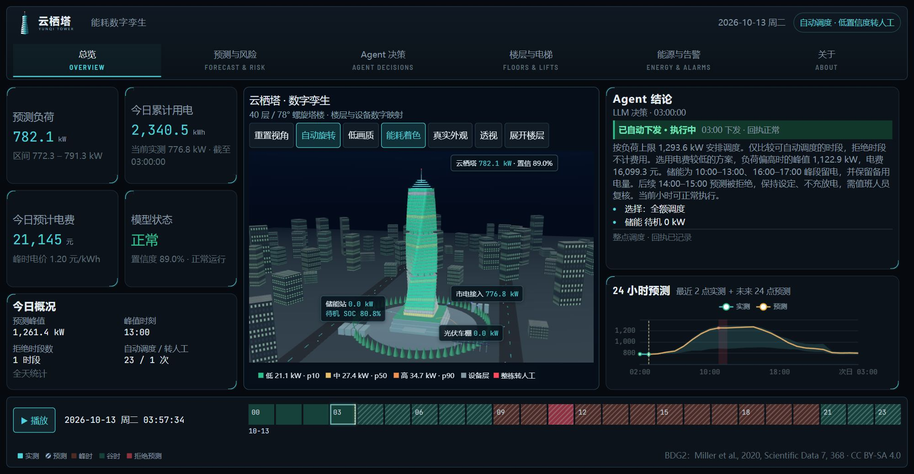
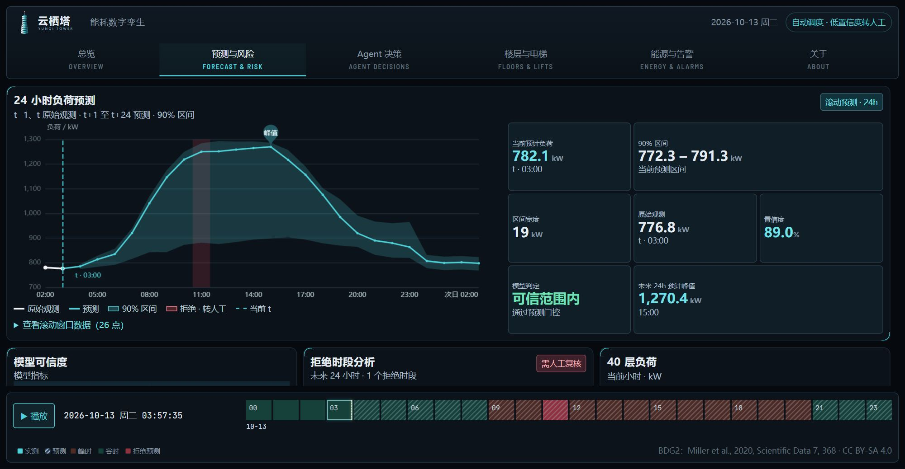
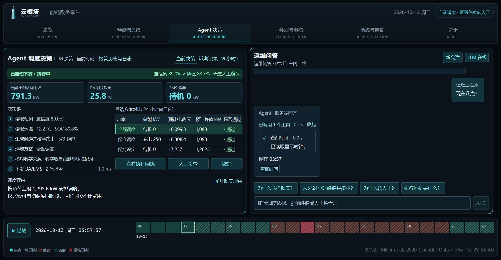
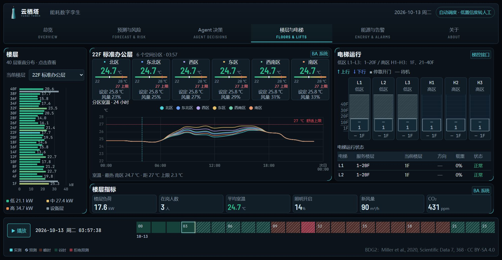
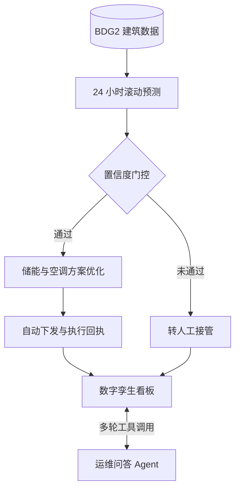

<p align="center">
  <picture>
    <source media="(prefers-color-scheme: dark)" srcset="twin/public/brand/yunqi-tower.svg" />
    
  </picture>
</p>

<h1 align="center">云栖塔 · 建筑能耗数字孪生</h1>

<p align="center">
  一栋塔楼的负荷预测、储能调度与运维问答，放进同一块实时看板。
</p>

<p align="center">
  
  
  
  
  
  
  <a href="exports/replay/LICENSE"></a>
</p>

<p align="center">
  <b>在线演示：<a href="https://aizudui.app">aizudui.app</a></b>（公开演示站，问答使用本地规则，不调用大模型）
</p>

<p align="center">
  <a href="#-功能亮点">功能亮点</a> ·
  <a href="#-界面预览">界面预览</a> ·
  <a href="#-系统架构">系统架构</a> ·
  <a href="#-快速开始">快速开始</a> ·
  <a href="#-数据与许可">数据与许可</a>
</p>

---

## 📖 项目简介

云栖塔是一个面向楼宇能源管理的数字孪生原型，数据基于公开的 [BDG2 建筑能耗数据集](https://github.com/buds-lab/building-data-genome-project-2)。它把三件事串在一起：

1. **预测**：滚动预测未来 24 小时的整栋负荷，并给出置信区间。
2. **决策**：Agent 在多个储能与空调方案中选出最优解，置信度达标就自动下发，达不到就转人工。
3. **呈现**：在 3D 塔楼、图表和运维问答里，实时展示每一步的依据和结果。

看板显示的是今天的真实日期和时间，播放头可以从当前时刻一直推进到 24 小时后。

## ✨ 功能亮点

| | 功能 | 说明 |
|---|---|---|
| 📈 | **24 小时滚动预测** | 逐小时预测负荷，附带置信区间；可靠性门控每天按近期误差重新校准 |
| 🔋 | **储能与空调联合调度** | 对比全额、保守、保持三种方案，兼顾峰值、电费、舒适度和设备约束 |
| 🚦 | **置信度门控** | 高置信方案自动下发，低置信转人工；人工可以接管、撤销，并查看执行回执 |
| 🏙️ | **3D 数字孪生** | three.js 渲染 40 层塔楼，楼层负荷、电梯运行、昼夜光影都跟着时间轴连续变化 |
| 💬 | **多轮工具调用问答** | 模型自己决定调用哪些只读工具（楼层读数、电价、储能、预测、联网检索等），可以多步、可以追问 |
| 🛡️ | **问答安全** | 数字逐句核对来源；涉政或时事话题自动识别并终止会话；API key 只留在服务端；按 IP 限流 |
| 🖥️ | **多端适配** | 桌面 1366 到 1920 宽、高分屏和手机都做了适配，字号不为排版让步 |

## 🖼 界面预览

| 总览 | 预测与风险 |
|---|---|
|  |  |
| **Agent 决策与运维问答** | **楼层与电梯** |
|  |  |

<details>
<summary>更多尺寸截图</summary>

| 尺寸 | 总览 | 预测与风险 | Agent 决策 | 楼层与电梯 |
|---|---|---|---|---|
| 1366×768 | [查看](docs/images/overview-1366.jpg) | [查看](docs/images/forecast-risk-1366.jpg) | [查看](docs/images/agent-decisions-1366.jpg) | [查看](docs/images/floors-lifts-1366.jpg) |
| 1920×1080 | [查看](docs/images/overview-1920.jpg) | [查看](docs/images/forecast-risk-1920.jpg) | [查看](docs/images/agent-decisions-1920.jpg) | [查看](docs/images/floors-lifts-1920.jpg) |
| 390×844 | [查看](docs/images/overview-390.jpg) | [查看](docs/images/forecast-risk-390.jpg) | [查看](docs/images/agent-decisions-390.jpg) | [查看](docs/images/floors-lifts-390.jpg) |

</details>

## 🧭 系统架构



| 层 | 技术 |
|---|---|
| 预测与优化 | Python · pandas · LightGBM · scikit-learn · SciPy |
| 服务 | FastAPI · Uvicorn · SSE 流式输出 · SQLite（接管与审计记录） · Redis（限流计数，可选） |
| 看板 | React · TypeScript · Vite · three.js · ECharts |
| 问答 | OpenAI 兼容接口，原生 function calling；没配置时退回本地规则回答 |

## 📂 目录结构

```text
src/          后端：数据处理、预测、调度、问答 Agent、API
twin/         前端：数字孪生看板（React + three.js）
configs/      模型、工具与设备配置
contracts/    前后端数据契约
exports/      看板使用的公开导出数据与模型卡
scripts/      服务管理、训练与导出脚本
experiments/  评测记录与研究产物
tests/        后端测试（前端测试在 twin/ 内）
docs/         设计说明与截图
```

## 🚀 快速开始

**环境要求**：Python 3.12、Node.js ≥ 22.12。

### 1. 启动后端

```bash
python -m venv .venv
source .venv/bin/activate        # Windows: .venv\Scripts\Activate.ps1
pip install -r requirements.txt
cp .env.example .env             # 默认不调用 LLM
python -m scripts.serve_backend start
```

启动后打开 <http://127.0.0.1:8000/health> 检查状态，接口文档在 <http://127.0.0.1:8000/docs>。

> 训练好的模型文件和原始数据不随仓库提供。原始数据请从 BDG2 下载，训练与导出方法见 [docs](docs/)。

### 2. 启动看板

```bash
cd twin
npm ci
npm run sync-replay
npm run dev
```

打开 <http://127.0.0.1:5173/?source=api>。开发服务器会把 `/api/*` 转发到后端。

### 3. 生产构建

```bash
cd twin
npm run build    # 产物在 twin/dist/，同时生成 .br / .gz 预压缩文件
```

部署时由任意静态服务器提供 `twin/dist/`，再把 `/api/` 反向代理到后端；流式问答记得关闭代理缓冲。

## 🤖 接入大模型（可选）

问答默认不调用任何大模型。要启用，在 `.env` 里配置一个 OpenAI 兼容的服务：

```ini
LLM_MODE=auto
LLM_BASE_URL=https://your-provider.example/v1
LLM_MODEL=your-model
LLM_API_KEY_FILE=/path/to/key-file   # 推荐用文件存放 key，不要写进仓库
# 可选：启用多轮工具调用问答
CHAT_AGENT_LOOP=1
```

- 所有模型请求都由后端发出，前端拿不到 key。
- 没有配置大模型时，看板在用户发出第一条问题后会显示提示条，问答退回本地规则回答。

### 限流

问答接口按访客 IP 限流，超限返回 HTTP 429 和 `Retry-After`，看板会显示倒计时提示。计数可以放在 Redis 里，多进程共享；Redis 不可用时自动退回进程内计数。

```ini
RATE_LIMIT_REDIS_URL=redis://127.0.0.1:6379/0   # 留空则只用进程内计数
RATE_LIMIT_IP_PER_MINUTE=10
RATE_LIMIT_IP_PER_DAY=200
RATE_LIMIT_LLM_PER_DAY=2000                      # 全站每天调用大模型的上限，用完后改用本地规则回答
```

部署在反向代理或 CDN 之后时，要让后端拿到真实访客 IP（例如 Uvicorn 的 `--proxy-headers`），否则限流会按代理节点的地址计数。

## 🧪 测试

```bash
python -m pytest -q          # 后端；部分测试需要本地数据和模型
cd twin && npm test          # 前端单元测试
cd twin && npm run test:e2e  # 端到端测试，需要 Edge 或 Chromium
```

## 📊 评测摘要

以下是本楼 2017 全年逐小时回测的结果，详见 [模型卡](exports/model_card.json)：

| 指标 | 结果 |
|---|---:|
| 全样本 MAE | 11.6 kW |
| 通过门控的样本 MAE | 10.3 kW |
| 区间覆盖率 / 拒绝率 | 90.7% / 15.8% |

> 调度节费等数字来自控制模型的计算，不是电表实测；本项目也没有连接真实楼宇设备。

## 📜 数据与许可

数据来源：[Building Data Genome Project 2](https://github.com/buds-lab/building-data-genome-project-2)

> Miller, C., Kathirgamanathan, A., Picchetti, B. et al. **The Building Data Genome Project 2, energy meter data from the ASHRAE Great Energy Predictor III competition.** *Scientific Data* 7, 368 (2020). <https://doi.org/10.1038/s41597-020-00712-x>

BDG2 数据及本项目由它改编而来的数据，按 [CC BY-SA 4.0](https://creativecommons.org/licenses/by-sa/4.0/) 分发，详见 [`exports/replay/LICENSE`](exports/replay/LICENSE)。数据许可不等同于代码许可。第三方依赖的许可见 [`THIRD_PARTY_NOTICES`](THIRD_PARTY_NOTICES)。

## 🙏 致谢

- 感谢 BDG2 项目公开的建筑能耗数据。
- 本项目由 Agnes Harness（AGH）协助开发。
